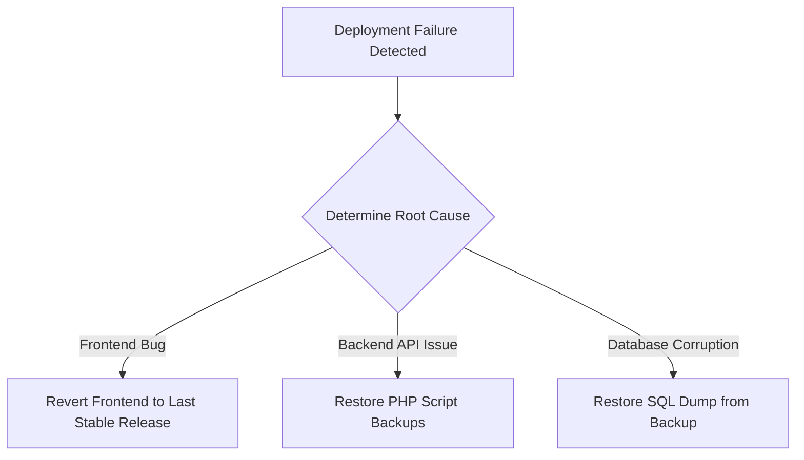

# Deployment & Operations Guide — Bichuten Data Vault

This guide details the deployment pipeline, infrastructure prerequisites, build steps, production setup, and roll-back strategies for the **Bichuten Data Vault** platform.

---

## 1. System Requirements

### Frontend Compile Machine
* **Node.js Environment:** **Node.js (v18.x or v20.x)** (LTS version is recommended).
* **Package Manager:** npm (v9.x or later).
* **Operating System:** Linux, macOS, or Windows 10/11.

### Production Web Hosting Server
* **Hosting Platform:** Hostinger Premium/Cloud, cPanel-compatible Shared/VPS hosting.
* **Web Server Engine:** Apache 2.4+ (with `mod_rewrite` enabled for SPA routing fallback).
* **PHP Interpreter:** **PHP 8.1 / 8.2 / 8.3**.
* **Database Engine:** MySQL 8.0+ or MariaDB 10.4+.
* **SSL Certificate:** Required (Let's Encrypt, Comodo, or Hostinger Free SSL) to enforce secure session cookie transfers.

---

## 2. Installation & Build Steps

Follow these steps on your development/runner environment to compile the application:

### Step 1: Install Node Dependencies
Open a command terminal in the root directory (containing `package.json`) and run:
```bash
npm clean-install
```
*Note: Using `npm clean-install` (or `npm ci`) guarantees clean installations matching the locked versions inside `package-lock.json`.*

### Step 2: Build the Production Bundle
Compile the optimized static bundle:
```bash
npm run build
```
This script runs the Vite compiler, generating production-ready HTML, JS, and CSS files inside the **`dist/`** directory.

---

## 3. Production Deployment Protocol

To push updates to production, execute the following steps:

```
[Local compilation] ──> [Connect via SFTP] ──> [Upload dist/ to public_html/] ──> [Upload backend/ to subfolder]
```

### Stage A: Frontend Distribution Deployment
1. Log into your server hosting control panel (hPanel/cPanel).
2. Open the **File Manager** and navigate to your domain's document root directory (`public_html/`).
3. Upload the files and folders from the local **`dist/`** directory directly into `public_html/`.
4. Ensure the `.htaccess` file is present in `public_html/` to support SPA routing fallbacks:
   ```apache
   RewriteEngine On
   RewriteBase /
   RewriteCond %{REQUEST_FILENAME} !-f
   RewriteCond %{REQUEST_FILENAME} !-d
   RewriteRule . /index.html [L]
   ```

### Stage B: Backend API Deployment & Production Configurations
1. In the same parent directory, create or navigate to:
   ```
   public_html/bichuten_backend/
   ```
2. Upload the files from the local `backend/` folder into `public_html/bichuten_backend/`.
3. Update the production parameters in `bichuten_backend/config.php`:
   * **Database Connection Details**:
     ```php
     define('DB_HOST', 'localhost');      // Hostinger / cPanel is typically localhost
     define('DB_NAME', 'prod_db_name');   // Production database name
     define('DB_USER', 'prod_db_user');   // Production database user
     define('DB_PASS', 'secure_pass');    // Production database password
     ```
   * **CORS Origin Whitelist**:
     Ensure your live production domains are whitelisted:
     ```php
     define('ALLOWED_ORIGINS', [
         'http://localhost:5173',          // Keep local dev
         'https://bichuten.com',           // Main domain
         'https://www.bichuten.com',       // Main domain with www
     ]);
     ```
   * **Site URL Verification**:
     Ensure the fallback case matches your production domain:
     ```php
     } else {
         define('SITE_URL', 'https://bichuten.com');
     }
     ```
4. Configure session security parameters in `bichuten_backend/admin/db.php`:
   * Set secure cookies over HTTPS (change from `0` to `1` on line 34):
     ```php
     ini_set('session.cookie_secure', 1); // Restricts cookie transmission to HTTPS only
     ```
5. Set permissions on `public_html/bichuten_backend/uploads/` to `755` (writable by web server processes).

### Stage C: Security Check & Verification
1. Access the web dashboard via `https://bichuten.com` and inspect the console logs to confirm no assets fail to load.
2. Navigate to `https://bichuten.com/admin/login` and verify that administrative auth cookies are sent exclusively over HTTPS (`session.cookie_secure = 1` inside [db.php](file:///d:/xampp/htdocs/Bichuten_Data_Vault/backend/admin/db.php)).
3. Test a public form (e.g. Careers resume upload) to verify that data is written to the database and PDF files are securely stored in `/uploads/` with filename hashing.


---

## 4. Rollback and Contingency Plan

If issues arise during deployment (e.g. site crashes, database corruption, or security loops), follow these instructions to revert changes.



### Option A: Frontend Reversion (Quick Rollback)
1. **Re-upload Staging Cache:** Maintain a copy of the previous deployment bundle (`dist_previous/`) on your backup folder.
2. **Restore Files:** Delete all files in the production root folder (`public_html/`) EXCEPT the `bichuten_backend` directory.
3. **Deploy Stable Backup:** Upload the `dist_previous/` files directly into `public_html/`. The platform will return to its previous state immediately.

### Option B: Backend Script Rollback
1. Overwrite the files inside `public_html/bichuten_backend/` (excluding `config.php`) with the codebase matching the last stable Git release branch.


