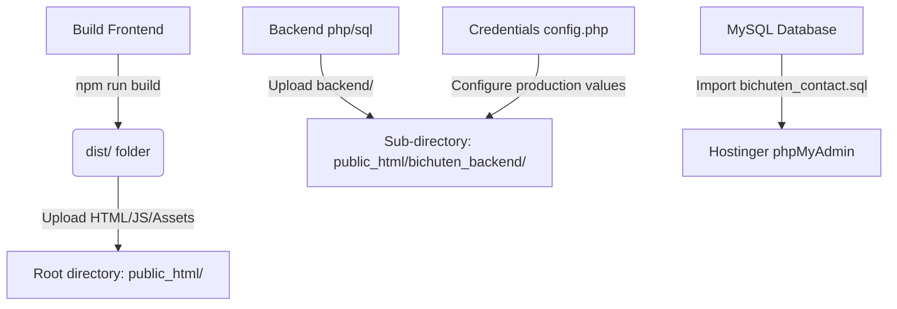
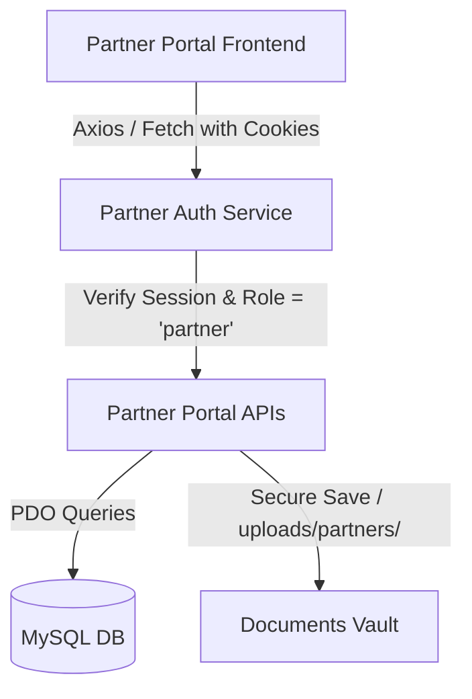

# Bichuten Data Vault — Handover Package & Transition Plan
**Prepared by:** Senior Solution Architect, DevOps Lead, and Technical Delivery Manager  
**Date:** June 22, 2026  
**Status:** Ready for Transition  

---

## 1. Executive Summary
This document outlines the complete technical handover package, codebase architecture, deployment runbook, and Partner Portal roadmap for the **Bichuten Data Vault** web platform. 

The website has been built with a modern React + Tailwind v4 + Vite frontend and a secure PHP session-based backend coupled with a MySQL database. This architecture is designed to support high-performance static rendering, interactive customer-facing portals, dynamic blogs/case studies, secure talent acquisition (careers), and structured audit logging. 

With future development moving in-house, this transition plan guarantees zero vendor lock-in, outlining environment setup steps, migration pathways, security compliance frameworks, and recommendations for developing the upcoming **Partner Portal**.

---

## 2. Current Project Structure

The codebase is split into a **Frontend (Vite + React)** project in the root and a **Backend (PHP + MySQL)** project located in the `backend` folder.

```
d:/xampp/htdocs/Bichuten_Data_Vault
├── .gitignore                      # Git configuration to ignore node_modules & uploads
├── README.md                       # Vite React template default readme
├── index.html                      # HTML entry point for React app
├── package.json                    # Node dependencies and project scripts
├── vite.config.js                  # Vite server proxy and bundler configuration
├── public/                         # Public static frontend assets
├── src/                            # Frontend source code
│   ├── App.css                     # Global styles
│   ├── App.jsx                     # Application routing & layout configurations
│   ├── index.css                   # Custom Tailwind directives and design tokens
│   ├── main.jsx                    # React index DOM mountpoint
│   ├── assets/                     # Frontend media, logos, and icons
│   ├── components/                 # Reusable layout elements (Navbar, Footer, etc.)
│   ├── pages/                      # Public website views (Home, Platform, Solutions, Careers, etc.)
│   └── admin/                      # Client-side Admin Panel Portal
│       ├── components/             # Admin layouts, Protected Route, and UI components
│       ├── context/                # AuthContext for admin session state management
│       ├── hooks/                  # Custom state hooks
│       ├── layouts/                # Admin sidebar and layout wrapping
│       ├── pages/                  # Admin dashboard views (SEO, Leads, Settings, Blogs, Media, etc.)
│       ├── services/               # Reusable API fetch wrappers (with CSRF support)
│       └── utils/                  # Date helpers and styling parameters
└── backend/                        # Server-side PHP backend
    ├── .htaccess                   # URL rewrite and PHP configuration overrides
    ├── config.php                  # Database, SMTP, CORS, and limits configuration (Centralized)
    ├── bichuten_contact.sql        # MySQL database structure and seed script (combined)
    ├── contact_api.php             # Contact form submission receiver API
    ├── newsletter_api.php          # Newsletter subscription receiver API
    ├── careers_api.php             # Talent application receiver with secure file uploading
    ├── uploads/                    # Server-side upload folder (secure storage)
    │   └── .htaccess               # Restricts direct script execution & access
    └── admin/                      # Private Admin Control Panel APIs
        ├── db.php                  # Database PDO initialization, sessions, & CSRF checking
        ├── auth/                   # Authentication endpoints (Login, Reset Password, Logout)
        ├── activity-logs/          # Admin Audit Logs endpoints
        ├── admins/                 # Administrator CRUD operations
        ├── blogs/                  # Blog category & post CRUD operations
        ├── case-studies/           # Case studies & metrics CRUD operations
        ├── leads/                  # Contact submissions retrieval & state updater APIs
        ├── careers/                # Job application retrieval & resume downloader APIs
        ├── newsletter/             # Newsletter subscriber list export APIs
        ├── settings/               # System settings store/update APIs
        └── media/                  # Image/Asset upload manager APIs for editor contents
```

---

## 3. Database Architecture

The system uses a single MySQL database schema. The complete DDL and default values are located in [backend/bichuten_contact.sql](file:///d:/xampp/htdocs/Bichuten_Data_Vault/backend/bichuten_contact.sql).

### Table Schema Summary

1. **`admins`**: Manages backend portal access.
   - Credentials hashed using standard `BCRYPT` (`$2y$10$...`).
   - Supports role-based access controls (`super_admin` vs. `admin`).
2. **`admin_activity_logs`**: Audit trail mapping the administrative actions, IP addresses, and timestamps.
3. **`contact_submissions`**: Stores messages from the "Request a Consultation" forms.
4. **`newsletter_subscribers`**: Email collection list for newsletters.
5. **`password_resets`**: Stores single-use tokens with dynamic expiration dates for secure forgotten password resets.
6. **`blog_categories` & `blogs`**: Hosts content, slugs, excerpts, body content, categories, and custom SEO configurations.
7. **`case_studies` & `case_study_metrics`**: Enterprise metrics dashboard data (e.g. "99.9% availability") and technical summaries.
8. **`career_applications`**: Secure storage of candidates' data including path mappings to their uploaded resumes.
9. **`website_settings`**: Key-value data store enabling admins to modify variables (phone, emails, CTA texts, SEO keywords, Google Analytics tokens) directly from the dashboard.

---

## 4. Development & Local Environment Setup

To run and modify this project locally, ensure you have **XAMPP** (or any AMPP stack supporting PHP 8.x + MySQL 8.x) and **Node.js (v18+)** installed.

### Step 1: Set Up the Backend & Database
1. Copy the contents of the `backend/` folder into your local XAMPP `htdocs/` subdirectory (or configure a local virtual host pointing to it).
2. Open **phpMyAdmin** (`http://localhost/phpmyadmin`).
3. Create a new database named `bichuten_contact`.
4. Import the file [backend/bichuten_contact.sql](file:///d:/xampp/htdocs/Bichuten_Data_Vault/backend/bichuten_contact.sql) inside the SQL tab to seed the structure and default admin credentials.
5. Open [backend/config.php](file:///d:/xampp/htdocs/Bichuten_Data_Vault/backend/config.php) and adjust the database credentials to match your local server environment:
   ```php
   define('DB_HOST', 'localhost');
   define('DB_NAME', 'bichuten_contact'); // Default local DB name
   define('DB_USER', 'root');             // Default XAMPP user
   define('DB_PASS', '');                 // Default XAMPP password (empty)
   ```

### Step 2: Set Up the Frontend
1. Open a terminal in the project's root folder (`d:\xampp\htdocs\Bichuten_Data_Vault`).
2. Install npm dependencies:
   ```bash
   npm install
   ```
3. Run the Vite development server:
   ```bash
   npm run dev
   ```
4. Access the site in your browser at `http://localhost:5173`.

### Vite Dev Proxy Magic
To prevent Cross-Origin Resource Sharing (CORS) roadblocks in local development, [vite.config.js](file:///d:/xampp/htdocs/Bichuten_Data_Vault/vite.config.js) uses a dev proxy. Requests beginning with `/bichuten_backend` are automatically proxied to your local Apache server (`http://localhost/Bichuten_Data_Vault/backend`).

> [!WARNING]
> If your local project folder is named differently than `Bichuten_Data_Vault`, update the rewrites in `vite.config.js` to match the exact URL path on your local Apache server.

---

## 5. Production Deployment Runbook (Hostinger / cPanel)

Follow these instructions to move the website to Hostinger or a similar cPanel hosting environment:



### Step 1: Deploy Frontend Assets
1. From the project root directory, run the production compiler:
   ```bash
   npm run build
   ```
   This generates a production bundle inside the `dist/` directory.
2. Log into the Hostinger File Manager.
3. Upload all files from the local `dist/` folder directly into the host's root directory (`public_html/`).

### Step 2: Deploy Backend Files
1. Copy the local `backend/` folder.
2. Upload and rename it to `public_html/bichuten_backend/` on the server.
3. Configure file permissions:
   - Ensure `public_html/bichuten_backend/uploads/` is writable (`755` or `777` depending on server configuration).

### Step 3: Configure Database & Settings
1. Create a MySQL Database and Database User via cPanel / Hostinger Panel.
2. Note down the Database Name, Username, and Password.
3. Access phpMyAdmin, select the new database, and import [backend/bichuten_contact.sql](file:///d:/xampp/htdocs/Bichuten_Data_Vault/backend/bichuten_contact.sql).
4. Edit `public_html/bichuten_backend/config.php` with the production database settings:
   ```php
   define('DB_HOST', 'localhost'); // Hostinger defaults to localhost
   define('DB_NAME', 'prod_db_name');
   define('DB_USER', 'prod_db_user');
   define('DB_PASS', 'secure_production_password');
   ```

### Step 4: Security Configurations
1. Update `ALLOWED_ORIGINS` in [backend/config.php](file:///d:/xampp/htdocs/Bichuten_Data_Vault/backend/config.php) to restrict CORS access to your live domains:
   ```php
   define('ALLOWED_ORIGINS', [
       'http://localhost:5173',
       'http://localhost:3000',
       'https://bichuten.com',
       'https://www.bichuten.com',
   ]);
   ```
2. Enable secure cookies over HTTPS. In [backend/admin/db.php](file:///d:/xampp/htdocs/Bichuten_Data_Vault/backend/admin/db.php), verify that the secure session setting is active:
   ```php
   ini_set('session.cookie_secure', 1); // Restricts cookie transmission to HTTPS only
   ```
3. Set the SMTP parameters in `backend/config.php` to enable password-recovery emails with the dynamic site URL resolving to the production domain:
   ```php
   define('MAIL_FROM_ADDRESS', 'noreply@bichuten.com');
   define('MAIL_FROM_NAME', 'Bichuten Admin');

   // Dynamic SITE_URL configuration
   if (isset($_SERVER['HTTP_HOST']) && ($_SERVER['HTTP_HOST'] === 'localhost' || strpos($_SERVER['HTTP_HOST'], 'localhost:') === 0)) {
       define('SITE_URL', 'http://localhost:5173');
   } else {
       define('SITE_URL', 'https://bichuten.com');
   }
   ```


---

## 6. Embedded Security Design

The architecture incorporates multiple protection layers designed specifically for data vaults and government-grade platforms:

* **Cross-Site Request Forgery (CSRF) Mitigation**: State-changing endpoints compare the client's `X-CSRF-Token` header with the token stored in the server session.
* **Rate Limiting**: Integrated file-based rate limiters inside [backend/admin/db.php](file:///d:/xampp/htdocs/Bichuten_Data_Vault/backend/admin/db.php) restrict consecutive requests (`LOGIN_MAX_ATTEMPTS`, `FORM_MAX_ATTEMPTS`) based on client IP addresses.
* **Secure File Upload Management**:
  - The careers endpoint hashes the filename and appends a `.bin` extension.
  - Files are written to `/uploads/` which has a local `.htaccess` containing:
    ```apache
    Deny from all
    RemoveHandler .php .phtml .php3
    AddType text/plain .php
    ```
  - This prevents web browsers from accessing the files directly, stops script interpretation, and neutralizes malicious file injections (e.g. PHP shell uploads). Resumes are downloaded through a protected gatekeeper script: `backend/admin/careers/download-resume.php` which executes `requireAuth()` first.
* **SQL Injection Prevention**: All endpoints use PDO parameter binding, ensuring query variables are securely parameterized.

---

## 7. Knowledge Transfer & Transition Plan

To ensure a smooth transition, we recommend a 3-week phased timeline:

```
[Week 1: Walkthrough & Local Setup] ──> [Week 2: Shadowing & Deployments] ──> [Week 3: Full Handover & Sign-off]
```

### Phased Schedule Checklist

| Phase | Tasks | Deliverables / Verification |
| :--- | :--- | :--- |
| **Phase 1: Setup** | <ul><li>Clone repo to internal git servers</li><li>Configure local MySQL and Apache instances</li><li>Verify Vite dev servers run locally</li></ul> | Development servers running locally. |
| **Phase 2: Review** | <ul><li>Review database schema and seed tables</li><li>Verify contact, newsletter, and career upload forms</li><li>Check admin audit trails</li></ul> | Form submissions appearing correctly in database tables. |
| **Phase 3: Deploy** | <ul><li>Prepare Hostinger hosting package</li><li>Execute a test deploy on a staging domain</li><li>Secure sessions and cookies</li></ul> | Secure staging site running over SSL. |
| **Phase 4: Launch** | <ul><li>Update dns records to point to live servers</li><li>Change seed admin password</li><li>Establish direct delivery ownership</li></ul> | Production site fully live. |

### Credentials Inventory

> [!CAUTION]
> The default credentials seeded in the database are for testing purposes only. Change these immediately after production deployment!

* **Administrative Login (Local / Seed)**:
  - **URL**: `http://localhost:5173/admin/login`
  - **Email**: `admin@bichuten.com`
  - **Password**: `Admin@2026!`
* **Local MySQL Seed Configuration**:
  - **Default Database Name**: `bichuten_contact` (changed dynamically via `config.php`)

---

## 8. Partner Portal Development Roadmap

The Bichuten team intends to construct a new **Partner Portal** on top of this structure. The portal will let partners upload security documents, track integration pipelines, view billing analytics, and manage collaboration agreements.

### Architectural Recommendation



To build this smoothly without breaking the core platform:
1. **Database Schema Enhancements**:
   - Create a `partners` table (name, company, email, status, password, created_at).
   - Create a `partner_documents` table to track uploaded partnership agreements and compliance certificates.
2. **API Isolation**:
   - Create a new directory under backend: `backend/partner/`.
   - Implement `db_partner.php` to handle partner-specific session checks. Ensure partner sessions do not overlap with admin sessions (use separate session namespace variables, e.g., `$_SESSION['partner_id']`).
3. **Frontend Routing Expansion**:
   - Set up a new sub-folder in the frontend: `src/partner/` (analogous to `src/admin/`).
   - Define a `PartnerRoute` gatekeeper component in `App.jsx` to block unauthorized public traffic from hitting partner modules.
   - Maintain uniform styling by consuming the design system values defined in [src/index.css](file:///d:/xampp/htdocs/Bichuten_Data_Vault/src/index.css).

---
*For any technical queries, the internal dev lead can contact the transition lead at tech-delivery@bichuten.com.*
