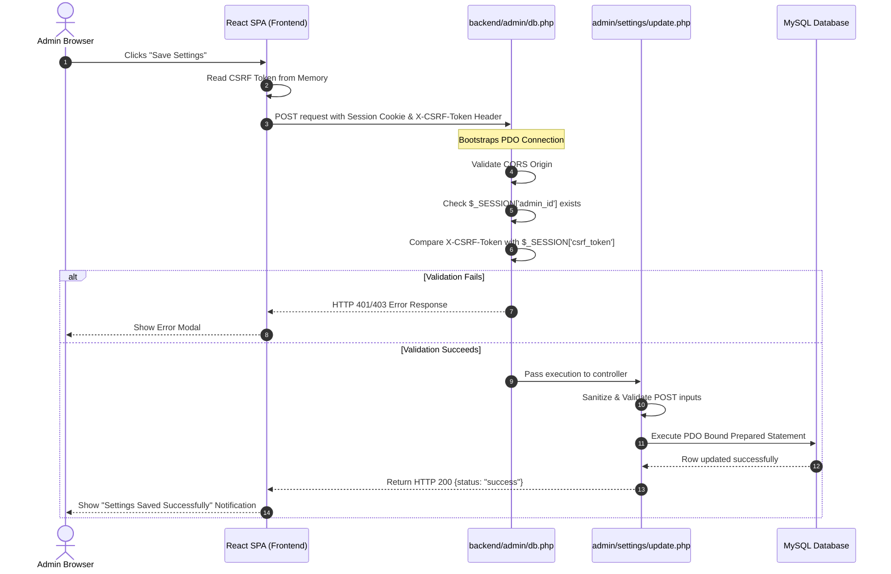
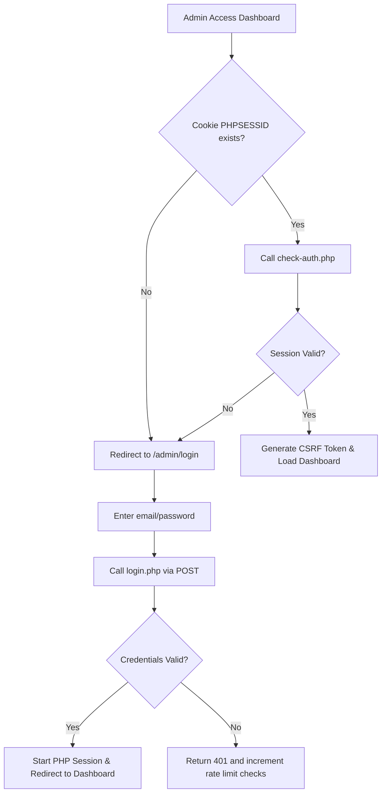

# Knowledge Transfer Guide — Bichuten Data Vault

This document provides a technical walkthrough of the platform's architectural blueprint, data transmission pipelines, administrative operations, content systems, and release procedures. It is designed to get incoming developers up to speed quickly.

---

## 1. System Architecture Explanation

The Bichuten Data Vault platform separates the **Static Frontend Interface** and the **Dynamic API Backend** to maximize performance, scalability, and security.

```
                  ┌─────────────────────────────────────────┐
                  │            Client Browser               │
                  └────────────────────┬────────────────────┘
                                       │
                    Requests /         │ /bichuten_backend/
                    Assets             │ (APIs & Uploads)
                                       ▼
                  ┌─────────────────────────────────────────┐
                  │          Apache HTTP Server             │
                  └────────────┬─────────────────────┬──────┘
                               │                     │
                  HTML/JS/CSS  │                     │ PHP Engine
                  (dist/)      ▼                     ▼
                  ┌───────────────────┐     ┌───────────────────┐
                  │  Static SPA File  │     │ PHP API Handler   │
                  │  (React Router)   │     │ (backend/ public) │
                  └───────────────────┘     └────────┬──────────┘
                                                     │
                                                     │ SQL queries
                                                     ▼
                                            ┌───────────────────┐
                                            │    MySQL Server   │
                                            │(bichuten_contact) │
                                            └───────────────────┘
```

### Key Architectural Concepts
1. **Separated Layer Design:** The frontend compiled output (`dist/`) lives directly in `public_html/`. The PHP backend files live in `public_html/bichuten_backend/`.
2. **Dynamic Client Routing:** The frontend utilizes `react-router-dom` to change views on the client side without requesting a full page reload.
3. **Session-Based State Control:** Authentication status is maintained via PHP sessions (`PHPSESSID` cookies) managed by Apache/PHP, rather than storing sensitive tokens in LocalStorage.
4. **Secure Asset Handover:** Customer-uploaded assets (like resumes) are hashed, converted to non-executable `.bin` binaries, and stored in a directory protected by `.htaccess` rules. They are only accessible via authenticated download proxy scripts.

---

## 2. Data Flow Diagram

The diagram below details the end-to-end data lifecycle when an admin updates website settings or posts a new blog article:



---

## 3. Administrative Workflows

The administrative dashboard uses a multi-layered security protocol to manage sessions and prevent attacks.



### Security Checks Checklist
* **CORS Origin Check:** The host domain must be whitelisted in the `ALLOWED_ORIGINS` array inside [config.php](file:///d:/xampp/htdocs/Bichuten_Data_Vault/backend/config.php).
* **HTTPS Enforcement:** The session cookie's `session.cookie_secure` flag must be set to `1` on staging and production to prevent session hijacking.
* **CSRF Token Synchronization:** During login/authentication verification, the backend generates a random token and returns it to the client. This token is stored in memory and sent with every state-changing request (POST, PUT, DELETE) inside the `X-CSRF-Token` header.

---

## 4. Content Management Flow

Creating and modifying articles (blogs, case studies) goes through the following validation pipeline:

```
[Write post in React Quill Editor] ──> [Upload featured image to Media API] 
                                                    │
                                                    ▼
[Execute PDO MySQL INSERT/UPDATE Query] ◄── [Validate fields, slugs & categories]
                                                    │
                                                    ▼
[Fetch via Public API] ──> [Sanitize HTML using DOMPurify] ──> [Render content safely]
```

1. **Rich Text Editing:** Authors write content using a `React Quill` editor, which outputs standard HTML.
2. **Media Insertion:**
   * Images uploaded inside the editor are processed by `backend/admin/media/upload.php`.
   * The API checks file extensions, enforces size limits (max 5MB), and moves images to `/uploads/`.
3. **Database Insertion:** The editor submits form payloads (title, slug, content, excerpt, SEO fields, og_image) to `update-blog.php` or `create-blog.php`. The backend saves this data using parameterized inputs.
4. **Secure Frontend Display:** When public users load articles, the frontend fetches the database payload. To prevent Cross-Site Scripting (XSS), the raw HTML content is sanitized using `DOMPurify` before being rendered.

---

## 5. Release & Deployment Workflow

The development lifecycle follows a Git-based release workflow to prevent breaking updates in production:

```
[Feature Branch] ──> [Local Tests] ──> [PR to main] ──> [Staging Run] ──> [Production Release]
```

### Step 1: Branch Management
* **`develop` Branch:** Active development branch. Feature branches are merged here.
* **`main` Branch:** Release-ready branch representing stable production code.

### Step 2: Quality Checks
Prior to running a release, developers must run the frontend compiler locally:
```bash
npm run build
```
This confirms that components compile correctly without syntax or dependency errors.

### Step 3: Deployment to Staging
1. Check out the `develop` branch.
2. Build the project:
   ```bash
   npm run build
   ```
3. Upload the build output (`dist/`) and `backend/` scripts to the staging folder environment (e.g. testing directory).
4. Verify that APIs, dashboard routes, and page styles function correctly.


### Step 4: Production Deployment
1. Merge `develop` into `main`.
2. Clean compile the project:
   ```bash
   npm run build
   ```
3. Backup the current production database and the `public_html/` folder.
4. Upload `dist/` contents to `public_html/`.
5. Upload updated `backend/` files to `public_html/bichuten_backend/` (avoid overwriting `config.php`).
6. Run smoke tests (login, submissions, log verification).
